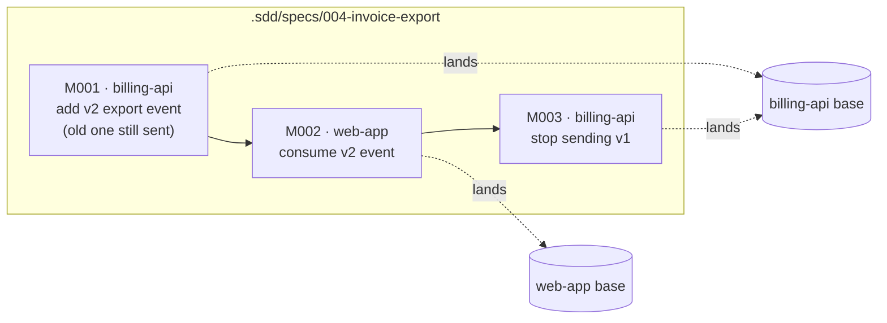

# Alper across repositories

**Status:** built as alper-brain 1.0.0. Drafted 2026-11-04; this records the reasoning behind the design. Where it and the skills disagree, the skills win.

Today alper works one repository at a time. Each repo keeps its pipeline state in `.sdd/`, which is local to one machine and kept out of git. The second brain is optional, and holds notes only. This proposal makes the brain the **hub** of the whole ecosystem. The team's knowledge is shared through it, your own pipeline work sits in one ignored `.sdd/` inside it, and `/brain` becomes the one command that sees every repository at once.

## Why

What breaks once you work across several repositories:

1. **A feature that spans repos has no home.** Changing an API and its web consumer takes two unrelated specs, one per repo, linked only by a `contract` note.
2. **In-flight checks stop at the repo boundary.** `IN-FLIGHT.md` only reads the current repo's `.sdd/specs/`. A spec you wrote in `billing-api` that changes an event `web-app` consumes never shows up when you plan work in `web-app`.
3. **Every view is assembled by hand.** The dashboard needs each repo added one by one, and the graph needs the brain folder. Nothing answers "what is going on across these repos?"
4. **Team settings are per machine.** `.sdd/settings.json` holds the commit key pattern, a team rule, yet every teammate sets it up again in every repo.

## The idea

One sentence: **knowledge is shared, work stays local, and both live in the brain.**

| | Today | Proposed |
|---|---|---|
| Notes (concept, decision, gotcha, contract, how-to) | brain, committed | brain, committed (unchanged) |
| Commit key pattern | `.sdd/settings.json` in each repo, local | brain `repos/<slug>/REPO.md`, committed |
| Specs, milestones, tickets, reviews | `.sdd/specs/` in each repo, local | brain `.sdd/specs/`, local |
| Research, onboarding tours, refactor reports | `.sdd/` in each repo, local | brain `.sdd/`, local |
| Brains on this machine | one, at `~/.alper/brain.json` → `path` | any number, one per knowledge base, each with its own notes, remote and `.sdd/`. Found by being open, so no path file |
| Where each repo is cloned on this machine | nowhere (the dashboard asks) | the brain's `.sdd/links.json`, local |
| `docs/STRUCTURE.md`, glossary, ADRs, suites in `CLAUDE.md` | repo, committed | repo, committed (unchanged) |
| Is the brain required? | no | yes, but **local-only by default**. It becomes shared the moment it gets a remote |

The brain commits a `.gitignore` holding `.sdd/`, so every teammate's clone ignores it the same way. `.sdd/` keeps its meaning (this machine's pipeline state) and only moves: from the root of each repo to the root of the brain. The format draft is [skills/brain/FORMAT.md](../skills/brain/FORMAT.md).

The brain holds what the code cannot tell you by looking, and what the team shares is only that. Specs stay what they are today: your working plan, from which knowledge is harvested when it lands.

## Work from the brain

You launch Claude in the brain's folder, and the brain stays open all day. Claude already knows its own working directories, so nothing has to record where the brain is.

The repos are different: a session only opens the ones today's work needs. So each registered repo moves through three states, and each state unlocks more:

| State | Means | Enough for |
|---|---|---|
| **registered** | the brain holds its `REPO.md` card | its notes, and specs that name it |
| **linked** | the brain's `.sdd/links.json` knows where this machine's clone is | reading its code: `status`, `ask`'s scouts, in-flight checks |
| **open** | that clone is a working directory of this session | changing its code: `build`, fixes, commits |

- **`/brain link`** writes `.sdd/links.json`. It matches each clone's `git remote get-url origin` against the `REPO.md` cards, scanning the workspace folder first. The file sits inside the ignored `.sdd/`, because paths differ per machine. Linking opens nothing.
- **Reading a linked repo that is not open** works by its path. Claude Code may ask you to allow those reads.
- **Changing one** needs it open. `/build` checks every repo its milestones touch, and asks you to run `/add-dir <path>` for each one that is not open yet before it starts.
- **`~/.alper/brain.json` goes away.** So does each skill's "read the path, fall back when missing" step.

What this costs: a session launched inside a repo, without the brain, has no brain. Skills then say so and tell you to launch in the brain, or to run `/add-dir <brain>`.

## Several brains

One machine can hold several brains. Each brain is a separate **knowledge base**: whatever you want kept apart, such as a company, a client, a field, or your side projects. For example, the `acme` brain covers Acme's repos and team, and `side-projects` covers your own. Each has its own notes, remote and `.sdd/`, and **nothing crosses between them**: a recall, a scout, a spec or a push in one brain never reads or writes another. That isolation is the point. One knowledge base's notes must never be pushed to another's remote.

With "work from the brain", choosing a knowledge base is choosing a folder: launch Claude in `acme`'s brain to work on Acme, and in `side-projects`' brain for your own. Each brain links only its own repos, so a session only ever sees one knowledge base's repos. The **active brain** is simply the open brain. In the rare session with two brains open, you name one (`/brain status @side-projects`), or else the one you launched in wins.

A repo can be registered in two brains, such as an open-source library both knowledge bases use. Each brain then keeps its own notes on it, and work in `acme` sees only `acme`'s notes. This duplicates some knowledge, but nothing leaks from one knowledge base to another.

## The central command

The ecosystem command is `/brain`, extended, rather than a new command. The brain is already the one thing that spans repos, and keeping one name means nobody has to learn another command. New branches:

| Branch | What it does |
|---|---|
| `/brain status` | The ecosystem at a glance: every registered repo (linked or not, open or not, dirty, unpushed `sdd/*` branches), your in-flight specs with their state, and the risks first: blocked or failed builds, specs waiting on a dependency, and contract changes whose consumers the spec leaves out. See [STATUS.md](../skills/brain/STATUS.md). |
| `/brain ask <question>` | Answers a question that crosses repos. It recalls the notes, picks the repos involved, sends one scout per repo in parallel, and answers with citations from each. Then it offers whatever the notes lacked as new notes. **This is also the answer to "how do I fill an empty brain"**: every cross-repo question you ask leaves notes behind. See [ASK.md](../skills/brain/ASK.md). |
| `/brain link` | Finds the local clones of registered repos and records their paths in the brain's `.sdd/links.json`, without opening them. It matches `git remote get-url origin` against each `REPO.md`, scanning the workspace folder first. Run it once per machine, and again when you clone another repo. |

`setup`, `recall`, `remember` and `sync` stay, and `view` replaces `graph`. See [SKILL.md](../skills/brain/SKILL.md).

The pipeline commands (`/brainstorm`, `/to-spec`, `/to-tickets`, `/build`, `/pr`, `/dashboard`) keep their names. What changes is where they look: specs are in the brain's `.sdd/`, and repos are found through the links. So you run them from the brain, whichever repo the work is in.

## Cross-repo specs

A spec names the repos it changes. Each milestone belongs to exactly one of them, because a milestone is built, checked and squashed inside one git history with one suite.

- `spec.md` gains a **Repos** line, and its module map tags each module with its repo. Each milestone gains a **Repo** line.
- **Spec ids keep `NNN`.** One machine writes them, so the next free number never clashes. It is now numbered across all repos rather than within one.
- **Branches** keep today's names in each repo: `sdd/<spec-folder>/spec` and `sdd/<spec-folder>/M<NNN>`. Each repo's spec branch holds only that repo's milestones.
- **`/build`** finds each milestone's repo through the links, asks you to open any that is not open yet, checks that its tree is clean, and builds there.
- **Landing** happens per repo. The **Landed** line becomes one entry per repo (`billing-api@3fa91c2, web-app@b77d012`). A spec counts as landed once every repo in **Repos** has landed it.
- **Contract changes are cut expand-then-contract** by `to-tickets`, the same way `WIDE-REFACTOR.md` cuts wide refactors: first add the new shape beside the old one, then move each consumer, then remove the old shape. Each step is a milestone that leaves every repo working. This matters because landing locally is not deploying: repos deploy on their own schedules.
- **In-flight checks cover every repo.** A spec overlaps when it shares a module in the same repo, **or** when it changes a contract that the new work produces or consumes.

## What stays local, and what that costs

Keeping specs out of the brain's git keeps the shared part small and conflict-free. There are no owners, no run state to merge, no SHAs that point at someone else's unpushed branches, and nobody sees your drafts. What you give up:

- **Teammates cannot see each other's in-flight work.** `status` and the in-flight checks cover only this machine's specs. Two people changing the same contract at the same time still find out at review or merge, as they do today.
- **A lost machine still loses its specs.** So harvesting knowledge at landing (LAND step 5) stays essential, and the knowledge inbox discussed earlier gets more valuable, not less: it would live at `.sdd/inbox/` in the brain.

If the first cost starts to bite, a small step fixes it without sharing specs. `to-spec` could add an **In flight** line to each `contract` note the spec changes, naming who changes it and how. That line is knowledge a teammate needs, and `LAND.md` removes it when the spec lands.

## What changes per skill

| Skill or file | Change |
|---|---|
| `brain` | New `status`, `ask` and `link` branches. FORMAT gains `REPO.md`, the brain's `.sdd/`, several brains, the active brain found among the open folders, and `.sdd/links.json`. `SETUP.md` asks whether to add a new brain or register the repo in an existing one, and its template writes the brain's `.gitignore`. `graph.html` draws `REPO.md` as the repo's hub. |
| `setup-repository` | Stops creating `.sdd/` in the repo. Writes the repo's `REPO.md` in the brain (commit key pattern, summary) and links it. `docs/STRUCTURE.md`, suites and the agent-file section stay. It folds into `/brain setup`, or the other way round: two setup commands per repo is one too many. |
| `to-spec`, `SPEC-ID.md`, `SPEC-TEMPLATE.md` | Write to the brain's `.sdd/specs/`. The template gains **Repos**, and the module map tags repos. |
| `IN-FLIGHT.md` | Reads every spec in the brain's `.sdd/specs/`, and adds the contract overlap. |
| `to-tickets`, `TEMPLATES.md` | Add the milestone **Repo** line, and cut contract changes expand-then-contract. |
| `build`, `LAND.md` | Build in the milestone's repo, once it is open, and land per repo. LAND step 5 stays as it is. |
| `research`, `onboard`, `improve-and-refactor` | Save to the brain's `.sdd/research/`, `.sdd/tours/<slug>/` and `.sdd/refactors/<slug>/`. |
| `dashboard`, `brain graph` | Become one page over the brain folder: the notes graph beside the specs, milestones and tickets, with each repo as a hub that both hang from. You pick one folder per knowledge base instead of one per repo. |
| `alper-flow` (mods) | Reads `.sdd/` from the brain it was launched in. Since you launch Claude in the brain, that path is the hook's `cwd`, as it is today. |
| `commit` | Reads the key pattern from `REPO.md`. |

## What gets harder

- **The brain is no longer optional.** Local-only by default softens this: a solo user never adds a remote, and gets today's behavior with the folder in a different place.
- **A session started inside a repo has no brain** until you open it. See **Work from the brain**.
- **Migration.** Existing `.sdd/specs/NNN-*` folders need moving from each repo into the brain. A `/brain migrate` would renumber them into one sequence, add each spec's **Repos** line, and rewrite **Depends on** lines.

## Decisions to settle

**Settled:**

- Specs and the rest of `.sdd/` stay local, ignored inside the brain. That removes the earlier questions about spec ids and run state.
- **Central command:** `/brain`, extended with `status`, `ask` and `link`.
- **The brain is required,** and local-only by default. Repos no longer keep a `.sdd/` of their own.
- **One setup command:** `setup-repository` folds into `/brain setup`.
- **One milestone builds in one repo.**
- **One page for the brain:** the notes graph and the specs, milestones and tickets, explored side by side over the brain folder. It replaces both the dashboard and the graph page.
- **A repo in two brains:** each brain keeps its own notes on it, and a run reads only the active brain's.
- **In-flight lines on contracts:** not now. Add them once teammates actually collide on a contract, as **What stays local, and what that costs** describes.

## Rollout

Each step ships something useful alone:

1. **See the ecosystem:** working from the brain, then `REPO.md`, `link`, `status` and `ask`. Until step 2 lands, `status` reads specs from each linked repo's own `.sdd/`. This step alone fills the brain through `ask`.
2. **Move `.sdd/` into the brain,** still single-repo: the `.gitignore`, `migrate`, alper-flow reading the brain, and the one brain page replacing the dashboard and the graph.
3. **Cross-repo specs:** the **Repos** and **Repo** lines, building across linked repos, landing per repo, expand-then-contract tickets, and the contract overlap in IN-FLIGHT.
4. **Polish:** the knowledge inbox.
