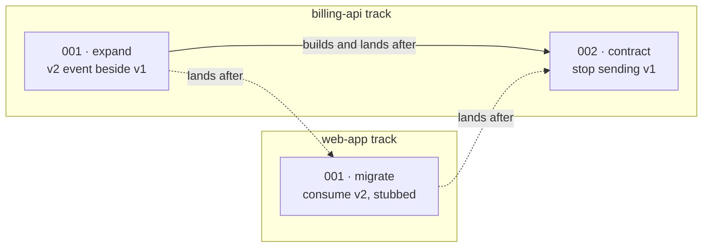

# Tracks: one line of milestones per repository

**Status:** proposed, 2026-11-05, with its open decisions settled the same day; rollout steps 1 to 3 built. Builds on [DESIGN.md](DESIGN.md)'s **Cross-repo specs**. Where it and the skills disagree, the skills win.

A spec that changes several repositories becomes one **track** per repository. Each track is the repository's own numbered milestones and tickets, built in order. The tracks run side by side, and each lands on its own base as it goes. The tracks are tied together in only two ways: a ticket that builds on another track's code, and a milestone that must land after another track's milestone. Today both ties are inferred from one global milestone number. Under this proposal, each one is written down where it applies.

## Why: what serializes today

Each claim below was checked against the skills as they stand.

| What blocks | Where | What it costs |
|---|---|---|
| **The number implies an order** | [to-tickets](../skills/to-tickets/SKILL.md) step 2 numbers milestones across the spec, while **Waves** ([build](../skills/build/SKILL.md) l.22) orders only within a repository and by **Depends on** | `M002` builds beside `M001`, so the number misleads the reader. A repository's branches can also start at `sdd/<spec>/M002`, with no `M001` in that repository |
| **Landing on a repository switch** | build step 1; [LAND.md](../skills/build/references/LAND.md) intro | Each time a wave moves on to another repository, the build stops, rebases, runs suites and asks the user |
| **Synchronized rounds** | build step 4: "Start the next round once every builder of this one has reported" | The slowest track sets the pace for every track |
| **Contract order as a build dependency** | [CONTRACT-CHANGE.md](../skills/to-tickets/references/CONTRACT-CHANGE.md): "each migrate's first ticket names the expand's last ticket" | No consumer starts until the producer's expand is squashed |
| **Serial closing** | Waves: "the review's sub-agents run from this session"; review-changes step 4 runs them in the foreground | A sub-agent cannot dispatch sub-agents. This one stays (see **Building**) |

Three corrections to the first analysis:

1. **Today the consumer's stub comes from the producer's code, not from the spec.** [CONTRACTS.md](../skills/tdd/references/CONTRACTS.md) builds each fake "from the producer's code at the commit this milestone builds against", and that is why the migrate waits on the expand. Building in parallel means the fake comes from the spec instead. Checking the fake against the real producer then moves from the migrate's first ticket to the migrate's close. That check needs a gate, described in **Contract changes**.
2. **The spec does not fix the contract's shape yet.** [SPEC-TEMPLATE.md](../skills/to-spec/references/SPEC-TEMPLATE.md) asks only for "API contracts, naming every other repository that consumes them", which is not enough to build a fake from. Building a consumer from a stub requires the spec to pin the shape.
3. **Parallel tracks make one existing read unsafe.** CONTRACTS.md reads the producer's code "by absolute path from the producer's root", which is that repository's working tree. While the producer's own track is building, that tree sits on whatever milestone branch is checked out. Every read of another track's code must go through `git -C <root> show <ref>:<path>`, never through the working tree.

## The model

```
.sdd/specs/003-invoice-export/
├── spec.md                      ← Repos, Key, Base, Landings, Landed
└── milestones/
    ├── billing-api/             ← one track
    │   ├── 001-<slug>/  milestone.md, 001-<ticket>.md, 002-<ticket>.md
    │   └── 002-<slug>/  milestone.md, 003-<ticket>.md
    └── web-app/
        └── 001-<slug>/  milestone.md, 001-<ticket>.md
```

- **Numbering is per track.** Milestones count `001` upwards within their repository. Tickets also count `001` upwards within their repository and continue across that repository's milestones.
- **Ids.** Inside its own track, an item is written `NNN`. From anywhere else it is written `<slug>/NNN`: `billing-api/002` for a milestone, and `billing-api/003` for a ticket in a **Depends on**. A milestone and a ticket can share a number, because the context always says which kind is meant. `/build` takes only a spec id: it builds every track (milestone mode was dropped, 2026-11-05).
- **Branches keep their names.** `sdd/<spec-folder>/M<NNN>` already lives inside one repository, so per-track numbers simply make each repository start at `M001`.
- **The folder is the repository.** The `**Repo:**` line in `milestone.md` would repeat the folder name, so it goes, and readers take the repository from the path.

The two ties between tracks are different relations, so each gets its own line:

| Relation | Line | Between | Means | Who writes it |
|---|---|---|---|---|
| **Depends on** | ticket | tickets, `NNN` or `<slug>/NNN` | this ticket's code builds on that one | to-tickets step 3 |
| **Lands after** | `milestone.md` | milestones in other tracks, `<slug>/NNN` | this milestone reaches its base only after that one reached its own | to-tickets step 2, by CONTRACT-CHANGE.md |

Inside a track, order needs no line: the track builds and lands in number order. Across tracks, a **Depends on** holds the ticket until the milestone it names is squashed, so the builder reads reviewed, final code. **Lands after** never holds a build back: it orders the landing, and holds a migrate at its contract check (`waits`) until its expand is squashed. (Step 2, still landing on a repository switch, needed a stopgap: a milestone also waited on whatever its **Lands after** target waited on, so a migrate never built ahead of its expand. Step 3's per-track landing and the `waits` phase made it unneeded.)



Within a track, a milestone builds and lands only after the one before it: `billing-api/002` starts once `billing-api/001` is squashed. Across tracks, building runs in parallel: `web-app/001` starts at the same time as `billing-api/001`, and keeps building while `billing-api/002` is under way. The dotted arrows order only the landings across tracks: the expand lands, then the migrate, then the contract.

Landing order therefore has two sources. Inside a track it is the number order, which needs no line. Across tracks it is **Lands after**, written only where a contract requires it. Two tracks with no **Lands after** between them land in whatever order they finish. The **Landings** line in `spec.md` only records the order that actually happened.

## Building

The main session is the only orchestrator, since a sub-agent cannot dispatch others. It runs as an **event loop**, and its builders run in the background. Background dispatch with a completion notification is the Agent tool's normal behaviour in Claude Code, and the build pane already accounts for background agents (`hooks/register.tsx`, `tick`).

1. **Start.** For each track whose next ticket is ready (its milestone is open, and every cross-track **Depends on** is squashed), set the ticket to `doing` and dispatch its builder in the background. At most one builder runs per track, because a track has one working tree.
2. **On each builder's report**, run BRIEF.md's **After a sub-agent that changes a repository reports** check. Then:
   - when the track's milestone still has a ticket in `todo`, dispatch the next one right away;
   - when that was the milestone's last ticket, put the milestone on the **closing queue**;
   - when the builder could not build its ticket, try a fixer once, as today. If that also fails, mark the ticket `blocked` and stop **that track only**. A milestone whose **Depends on** reaches the blocked one never becomes ready, and a migrate whose expand is blocked builds as far as `waits`. Every other track keeps building.
3. **Close** one queued milestone at a time, in the main session: steps 6 to 10 of the build, with review, decide, fix, check and squash. Builders in other tracks keep running meanwhile. Their notifications wait until the closing step that is running returns, which is the one serialization left.
4. **After each squash**, land what has become landable (see **Landing**), then open the track's next milestone and go back to step 1 for that track.
5. **Drain** when no builder is running and nothing is ready. The drain hands over: what was built, which tracks are blocked and why, and which landings wait on a gate.

A milestone's close can also wait on another track: a migrate's check (step 9) needs its producer's expand to be squashed. While it waits, its **Phase** reads `waits`, and the build pane shows it as waiting rather than failed.

## Landing

A milestone is **landable** when all three hold: it is squashed, every earlier milestone in its track is landed or landable, and every milestone its **Lands after** names has landed.

- **When it lands.** A track lands only while it is **idle**, between a squash and its next milestone's branch. That keeps a rebase of `sdd/<spec>/spec` from happening under a milestone that is mid-build. In practice, the moment is right after each squash, or at the track's next squash if a gate was still closed.
- **A prefix, not the whole spec branch.** A gate can hold one milestone back while later ones in the same track are already squashed, for example a contract waiting on its consumers. LAND then fast-forwards the base to the rebased commit of the last landable milestone instead of to the branch tip. Since the rebase rewrites the SHAs, LAND writes each milestone's rebased commit back into its **Squash** line, found by its unique subject among the spec branch's own commits; a fix made while readying a landing is folded into the last squash. A milestone has landed once its **Squash** commit is on its base, and that same commit is its **Landed**, so a call resumed after its merge records exactly what the first would have.
- **One question per call.** At the start of each `/build` call, ask once whether to land each track **as it goes** or **hold every landing for the end**. Without that, every landing would stop the event loop to ask for approval while builders are still running.
- **Recording the order.** Each landing appends to a new `**Landings:**` line in `spec.md`, for example `billing-api 001; web-app 001; billing-api 002`. This line is the only record of the order the bases actually took, so [pr](../skills/pr/SKILL.md)'s landings and [SERIES.md](../skills/pr/references/SERIES.md)'s Merge Order read it in place of "milestone order".

## Contract changes

The order stays the same: **expand → migrates → contract**. What changes is where the order lives: it moves from build to landing.

1. **to-spec pins the shape.** Each entry under API contracts gives the route or event, every field with its type and whether it is optional, and the old shape it replaces. The entry must be precise enough for a consumer to fake. The **Done when** of to-spec step 6 checks for this.
2. **to-tickets cuts by Lands after.** Each migrate has **Lands after** the expand, and the contract has **Lands after** every migrate. No **Depends on** crosses tracks just to hold that order.
3. **The consumer builds against the spec.** Its fake comes from the pinned shape, and the fixture's comment names the spec and the section the fake was built from (CONTRACTS.md changes accordingly).
4. **The contract check gate.** Once the expand is squashed, the migrate's check (build step 9) adds one step. A `spec-reviewer` compares each fake against the producer's code at the expand's **Squash**, read with `git show`. When they drift, a fixer runs in the consumer before the squash, so the milestone still squashes into a single commit.
5. **Fallback.** When the shape cannot be pinned before building, because it is still being discovered, the migrate keeps today's cross-track **Depends on** on the expand's last ticket, and the quiz says why.

## Context in the orchestrator, and the handoff

The event loop collects in one conversation every builder report, every review report shown to the user, every arbiter answer and every landing. `/build` already resumes from files: **Status**, **Phase**, **Squash** and **Landed** hold its place. So the cure is to make the files the complete handoff, plus a skill for the part that lives only in the conversation.

### What lives only in the conversation today

| State | Today | Proposed |
|---|---|---|
| **Needs the user** items from sub-agent reports | listed only in the hand-over (build intro) | build appends each one to its ticket's Notes as `Needs the user: …`, and the hand-over reads them from there |
| **Running background builders** | not on disk anywhere | a resume treats a `doing` ticket as interrupted, which is only safe once no builder from the earlier session is still running. Build therefore **drains** before handing over: it stops dispatching, waits for the running builders, then stops |
| **Landing approval** | asked again in every call | asked once per call; a new session asks again |

**Drain points.** Build drains and hands over `/build <spec-id>` for a fresh session in three cases: when the user asks for a handoff, after every 3 milestones closed (a count, since the model cannot measure its own context), and at the drain in step 5 of **Building**.

### A `handoff` skill

Adapted from Matt Pocock's `handoff` (`skills/productivity/handoff` in mattpocock/skills). That skill compacts the conversation into a document for a fresh agent. It references artifacts by path instead of copying them, adds a "suggested skills" section, redacts secrets, and takes as its argument what the next session will be used for. What changes for the brain:

- **Where it writes.** The file goes to `.sdd/handoffs/NNN-<slug>.md` in the brain, not to the OS temp folder. Pocock uses temp to keep the workspace clean, and the brain's `.sdd/` is already local and ignored. A file there survives a reboot, and `/brain status` can list the latest one.
- **Single source of truth.** The handoff carries only what no file carries yet: the goal, the decisions taken in conversation, what was tried and failed, the open questions, and the next command. Everything else goes in as a pointer: the spec folder, `milestone.md`, `review.md`, the branches in each repository. When a decision belongs in the spec's Further Notes or in a brain note, the skill offers to write it there first, so the decision outlives the handoff.
- **User-invoked only** (`disable-model-invocation: true`, as in Pocock's version). Its description then costs no context load, and build's drain needs no skill because its state is already on disk.
- **Done when** the file ends with the first prompt for the next session (the command plus the handoff's path), and that prompt plus the file's pointers are enough to take the next step without this conversation.

Write the skill by `writing-for-agents`, as CLAUDE.md requires.

## What changes per file

| File | Change |
|---|---|
| `to-tickets/SKILL.md` | Step 2 cuts tracks and drops "keep a repository's milestones together". Step 3 numbers tickets per track. Step 4's quiz shows tracks and the landing order instead of waves. Step 5 uses the new layout and the new `/build` ids |
| `to-tickets/references/TEMPLATES.md` | Drop **Repo**, add **Lands after**. A ticket's **Milestone** and **Depends on** take `NNN` or `<slug>/NNN` |
| `to-tickets/references/CONTRACT-CHANGE.md` | Order held by **Lands after**, build in parallel against the pinned shape, the contract check gate, the fallback |
| `to-spec/references/SPEC-TEMPLATE.md`, `to-spec/SKILL.md` | API contracts pin the shape; step 6's Done when checks it |
| `tdd/references/CONTRACTS.md` | The consumer's fake comes from the spec's shape, and is checked against the producer at close; read the producer only through `git show` |
| `build/SKILL.md` | **Waves** becomes tracks and an event loop. Background builders, the closing queue, blocking per track, the `waits` phase, drain points, and Needs-the-user items written to Notes |
| `build/references/LAND.md` | Landable, idle tracks, landing a prefix, one question per call, the **Landings** line |
| `brain/references/FORMAT.md` | Layout, ids, **Lands after**, **Landings**; the **Repo** line removed |
| `brain/references/SETUP.md` l.36, `review-changes/SKILL.md` | A milestone is found by repository and `NNN` |
| `brain/references/STATUS.md` | `building` names each track's current milestone instead of the wave |
| `brain/references/MIGRATE.md` | A new step for ticketed specs: move milestones into `<slug>/`, renumber them and their tickets per track, rewrite **Depends on**, rename `sdd/<spec>/M<NNN>` branches, and write **Landings** from the old order. A migrated spec keeps its cross-repo Depends-on edges for contract order: they are stricter than **Lands after**, never wrong |
| `brain/brain.html` | The path parser (`p.length === 4`) gains the repository segment; milestones are keyed by `repo/NNN`; tracks can draw as swimlanes |
| `hooks/sdd.ts`, `hooks/register.tsx`, `register.test.tsx` | `SDD_PATH` and `SddRef` gain `repo`; `keyOf` and the label use it; `repoField` reads the path; `STAGES` and `stageOf` learn `waits` |
| `pr/SKILL.md`, `pr/references/SERIES.md` | Landings and Merge Order come from **Landings** |
| `skills/handoff/` (new) | See above |
| `README.md`, `docs/DESIGN.md` | The cross-repo section points here |

## What gets harder

- **The orchestrator becomes an event loop.** It is harder to follow than rounds, and it depends on the resume rules being right. That is why the drain exists.
- **Stub drift shows up later**, at the migrate's close instead of at its first ticket. The fix runs inside the milestone, but a large drift wastes the migrate's tickets. Pinning the shape in to-spec is the defence.
- **Landing as it goes means more landings**, and so more PRs in a series. Choosing "hold for the end" gives one landing per track, plus the one the contract gate forces.
- **A single track stays serial.** The spec's wall time becomes the longest track plus the closing queue. Building one track's next milestone during its predecessor's close would need one git worktree per milestone, which this proposal does not take on.
- **Readers must handle two layouts** until every brain has migrated.

## Decisions

**Settled** (2026-11-05):

1. **Landing approval is asked once per `/build` call:** land each track as it goes, or hold every landing for the end. A new session asks again.
2. **A cross-track Depends on waits for the named ticket's milestone to be squashed,** not just for the ticket's `done`, so the builder reads reviewed code.
3. **The Repo line goes.** The `milestones/<slug>/` folder is the only source of a milestone's repository.
4. **Handoffs live in the brain's `.sdd/handoffs/`,** local and ignored, rather than in the OS temp folder.
5. **The build drains after every 3 closed milestones.** Each close brings a review report, the arbiter's answers and a landing into the orchestrator's context. 3 is a starting value, to be tuned once real builds show how much context a close costs.
6. **In-flight specs are migrated,** with their branches renamed, at the start of the next `/build` on them. No sub-agent runs at that moment, so a milestone moves at whatever **Phase** it is in: its folder, its `review.md` and its branch move together, and the review's fixed point, a merge-base, survives the rename. (The first draft let a spec mid-close finish in the old layout, but the new build no longer reads the flat layout.)

## Rollout

Each step ships alone:

1. **Layout and ids** (built). Tracks, per-track numbering, `<slug>/NNN` ids, the **Landings** line, the readers (FORMAT, hooks, `brain.html`, SETUP, review-changes, STATUS, IN-FLIGHT), pr and SERIES, and MIGRATE's **Tracks**. The build keeps its rounds and its landing on a repository switch, with waves computed from tracks; contract order is still held by cross-track **Depends on**. **Landings** moved into this step because the global milestone number, which pr used to order a series, is gone.
2. **Contracts from the spec** (built). **Lands after**, with its waits inherited in **Waves**, the pinned shape (SPEC-TEMPLATE, to-spec), CONTRACTS.md, CONTRACT-CHANGE.md, and the contract check in build step 8. Migrates now build beside their expand. Inside a wave, the expand closes first, so the check never waits: the `waits` phase stays with step 3, where tracks stop sharing waves.
3. **The event loop and landing per track** (built). Background builders, the closing queue, blocking per track, the `waits` phase in the build pane and the brain page, LAND's **Land a track** with prefix landing, and the one landing question per call. Step 2's inherited waits are gone. A landing whose suite fails below the branch's tip stops its track rather than fixing, since the fix would have to rewrite the squashes above it.
4. **Handoff.** Needs-the-user items in Notes, the drain, and the `handoff` skill.
